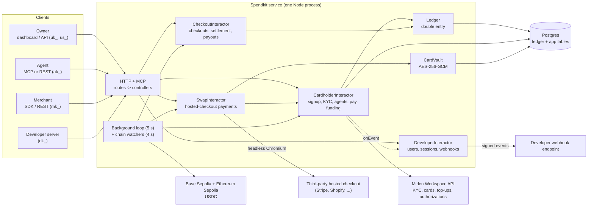
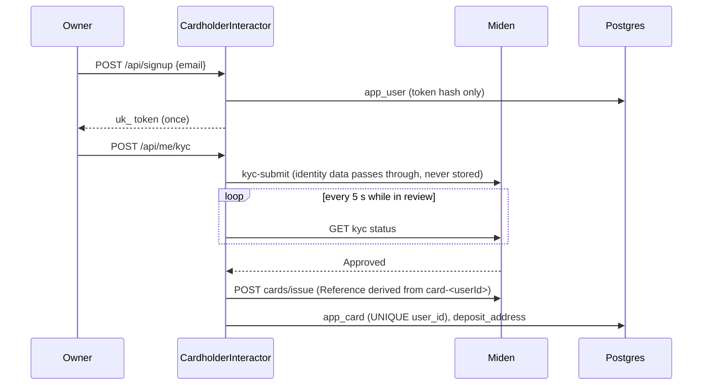
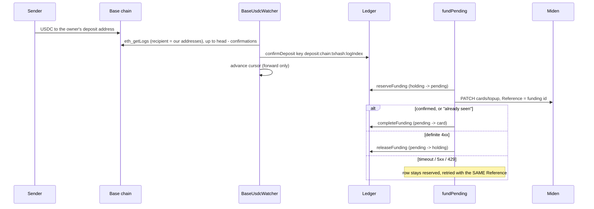

# Architecture

How Spendkit is built: the parts, how money and data move between them, and why it is shaped this way. This is the map. The per-area docs (linked throughout) hold the detail and the runbooks.

Written 2026-10-26 from the code on `main` plus the working tree. **Sandbox only:** `src/main.ts` refuses to start unless `MIDEN_BASE_URL` is the Miden sandbox. What blocks production is in [production-gaps.md](production-gaps.md) and [checkout-payouts.md](checkout-payouts.md#before-mainnet).

## Contents

1. [What the system does](#1-what-the-system-does)
2. [The big picture](#2-the-big-picture)
3. [Actors and credentials](#3-actors-and-credentials)
4. [Design decisions](#4-design-decisions)
5. [Components](#5-components)
6. [The ledger](#6-the-ledger)
7. [Key flows](#7-key-flows)
8. [Data model](#8-data-model)
9. [External systems](#9-external-systems)
10. [Process model and background work](#10-process-model-and-background-work)
11. [Security model](#11-security-model)
12. [Failure handling](#12-failure-handling)
13. [Testing](#13-testing)
14. [Known limits](#14-known-limits)
15. [Where to read next](#15-where-to-read-next)

## 1. What the system does

Spendkit gives AI agents a way to pay for things without a human handing over a card number. It is built on the [Miden Workspace API](miden-api.md), a card-issuance REST API (not the Miden blockchain).

- A person (the **owner**) passes card KYC once and gets **one real Visa card** under their own Miden customer.
- The owner funds it by sending **USDC on Base** to a deposit address tied to that card.
- The owner carves **agent wallets** out of the card balance. Each is a ledger sub-balance with its own spend policy (per-transaction limit, daily limit, merchant-category allowlist) and its own token.
- **Agents** pay over MCP or REST. They never do KYC and never see card details.
- **Merchants** can take agent payments through hosted checkouts and are paid out in USDC.
- **Developers** can embed all of this in their own product: they create users and agents through an API and get signed webhooks.

Amounts are **integer USD cents** everywhere inside the system. Dollars exist only at the Miden boundary; stablecoin base units are converted with `bigint` and floored to cents.

## 2. The big picture



The pre-rendered picture used in the README is [architecture.png](architecture.png) ([svg](architecture.svg)). It shows the money path only; this page is the full structure.

One process does everything: it serves HTTP and MCP, runs the chain watchers, and runs the background loop. Postgres is the only state. See [section 10](#10-process-model-and-background-work).

## 3. Actors and credentials

Every credential is a bearer token with a type prefix. Only the **SHA-256 hash** is stored; the plaintext is returned once at creation.

| Prefix | Holder | Opens | Notes |
| --- | --- | --- | --- |
| `uk_` | An owner | `/api/me/*`: KYC, card, agents, deposits | Shown once at signup. No expiry or rotation yet; no recovery flow. |
| `us_` | One end user's browser, issued by a developer | `/api/me/*` for that one user, plus the hosted `/connect` page | Expires (default 1h, max 24h). Cannot mint a permanent token. Passed in the URL fragment so it never reaches a server log. |
| `ak_` | One agent | `/mcp` and `/agent/v1/*`, inside that agent's limits | Revoking the agent kills the token at once. |
| `mk_` | A merchant | `/merchant/v1/*` | Can be rotated. |
| `dk_` | A developer's server | `/developer/v1/*`, for that developer's users only | A user that is not theirs is a 404. |
| `whsec_` | A developer | Signs outgoing webhooks | Shown once; stored readable (we must sign with it). |

Public, unauthenticated: the landing page, `/healthz`, the checkout page `/pay/cs_...` and `GET /v1/checkouts/cs_...`, and the three signup endpoints.

## 4. Design decisions

These are the choices that shape everything else. The date is given where one was recorded.

| Decision | Why |
| --- | --- |
| **One real card per owner; agents are ledger sub-balances** | Miden caps a customer at 3 cards (sandbox), an AI agent cannot be a KYC subject, and retail cards cannot be issued under a KYB business customer. So agents need no KYC and cost no extra cards. |
| **Integer cents and double-entry, enforced in the database** | Money bugs are the expensive kind. Triggers and CHECK constraints make the invariants hold even if application code is wrong. |
| **Idempotency keys on every money movement** | Retries, crashes and double-clicks must never double-count. |
| **We do not store identity or card data (with one exception, the vault)** | KYC documents go straight to Miden; we keep a reference and a status. Card details are stored only when `CARD_VAULT_KEY` is set, encrypted, for the hosted-checkout feature. |
| **Polling, not webhooks, from Miden** | Subscribing is blocked on Miden's side, and its webhook signature does not cover the body. KYC and balances are polled; amounts are always re-read from the API. |
| **Poll the chain with `eth_getLogs`, not a provider webhook** | A provider webhook may later be a second signal, never the source of truth. |
| **We are merchant of record for checkout (2026-10-19)** | Card details reach neither agents nor merchants. Merchants are credited on `paid` and paid out in USDC. |
| **Payout rail is USDC on Base Sepolia only (2026-10-19)** | Bank transfers later. `UsdcPayoutRail` refuses mainnet. |
| **Single process, in-process locks** | Simple for a sandbox. The ledger itself is safe under concurrency; the app-layer locks are the part that assumes one instance. |
| **Sandbox-only guard at boot** | A live card must not be charged by accident. Outside the sandbox `doPay` throws. |

## 5. Components

### 5.1 Source layout

The service is layered as follows:

```
routes/ -> controllers/ -> lib/interactors/ -> lib/services/ -> db/repositories/
                                            -> adapters/     -> lib/clients/ (external APIs)
```

Wired at the top by `bootstrap.ts` (env -> `AppParams`) and `createApp.ts` (`AppParams` -> interactors).

| Path | Responsibility |
| --- | --- |
| `src/main.ts` | Entry point: bootstrap, createApp, restore, start workers and the HTTP server, shut down on signals |
| `src/bootstrap.ts` | Reads the environment once; builds every client, repository and adapter into `AppParams` (`domain/types/ContextTypes.ts`). Sandbox guards live here |
| `src/createApp.ts` | Builds the interactors from `AppParams`; `AgentCardsApp` is what controllers receive |
| `src/startAppServer.ts`, `src/createHttpServer.ts` | Listens on IPv4 + IPv6 loopback; request guards, router, error handler |
| `src/startBackgroundWorkers.ts` | Chain watchers and the 5-second background tick |
| `src/startMcpStdio.ts` | MCP over stdio, a bridge to the agent REST API |
| `src/errors.ts` | `AgentCardsError` + `ErrorCodes` and the factories (`badRequestError`, `notFoundError`, `conflictError`, ...); the code picks the HTTP status |
| `src/router.ts`, `src/routes/` | Route tables per surface: `publicRouter`, `webhooksRouter`, `mcpRouter`, `agentRouter`, `merchantRouter`, `developerRouter`, `ownerRouter` |
| `src/controllers/` | One file per surface. Read `req.params` / `req.body` / `req.callerId` / `req.agent`, call one interactor, send the response. No business logic |
| `src/lib/middleware/` | `requestGuards` (Host, Origin, JSON-only POST, webhook-only hosts), `auth` (`authorizeUser`, `authorizeAgent`, `authorizeMerchant`, `authorizeDeveloper`), `bodyParser` (`jsonBody`, `rawBody`) |
| `src/lib/http/` | `Router` (a small Express-shaped router over `node:http`) and `sendJson` |
| `src/lib/interactors/` | Use cases: `CardholderInteractor` (signup, KYC, card, deposits, agents, `pay`, reconcile), `CheckoutInteractor`, `PayoutInteractor`, `SwapInteractor`, `DeveloperInteractor` |
| `src/lib/services/` | Business rules: `Ledger` (double entry), `AgentWallets` (agent sub-balances, `spend()` check order), `spendPolicy` (`evaluate()`), `tiers` |
| `src/lib/clients/` | External API clients: `cardIssuing/miden/` (`MidenClient`, request signing, card-detail decryption, webhook signature) and `circle/CircleClient` |
| `src/adapters/` | Our side of each integration: `virtualCards/` (`CardService`, `CardLifecycle`), `funding/` (`MidenWalletFunding`), `deposits/` (`BaseUsdcWatcher`, `CircleDeposits` webhook processor, `simDeposit`), `payouts/` (`UsdcPayoutRail`), `checkoutFillers/` (Stripe, Shopify, Lemon Squeezy, Paddle, with local fixtures), `cardVault/` (`SealedCardVault`: seals in-process, stores through `CardVaultRepository`), `wallet/` (`HdDepositWallet`), `onboarding/` (Card KYC) |
| `src/db/schema/` | The Drizzle schema: every table, key, index and CHECK as TypeScript, one file per area |
| `src/db/client.ts` | `createDatabase(pool)` (the Drizzle handle), `Executor`/`Transaction` types, Postgres error helpers |
| `src/db/repositories/` | One `createXRepository(db)` factory per aggregate, gathered by `createRepositories(db)`; plus `createLedgerStore`, `createChainRepositories` (cursors, deposit addresses) and `MemoryLedgerStore` for unit tests |
| `src/db/migrate.ts`, `src/db/migrations/` | Reviewed SQL migrations, applied in order at boot under an advisory lock |
| `src/db/locks.ts` | Advisory lock keys and helpers |
| `src/domain/` | `interfaces/` (`FundingSource`), `repositories/` (one interface per repository), `types/` (`AppParams`, `AppRequest`, `Entities`: stored records inferred from the schema) |
| `src/presentation/` | Static site (`web/`), `staticFiles.ts`, the checkout page, the agent MCP server definition |
| `sdk/checkout/` | `@agent-cards/checkout`, the merchant and agent client SDK |
| `examples/` | `shop/` (a complete merchant) and `developer/` (runnable demos of the developer API) |
| `scripts/` | Sandbox bring-up, quickstart, end-to-end demo, Miden probes, swap rehearsals |
| `test/` | `node:test` suites |

### Data access (Drizzle ORM)

Interactors never see SQL or the connection pool. They receive the repositories they use (`users`, `spends`, `checkouts`, ...) through their context; each repository is an interface in `src/domain/repositories/` implemented by a factory in `src/db/repositories/` with the Drizzle query builder, and returns typed records (`src/domain/types/Entities.ts`: camelCase, cents as safe integers, timestamps as `Date`).

- **Transactions** live inside repository methods: an operation that must be atomic (lock a row, check, write) is one method that runs `db.transaction`, so callers cannot leave one half open.
- **Locks** use the builder (`.for("update")`, `skipLocked`); advisory locks go through `src/db/locks.ts`, where every key is listed.
- **Money columns** are `BIGINT` read through `bigintNumber` (`src/db/schema/columns.ts`), which throws instead of rounding anything past 2^53.
- **`sql` fragments** appear only inside repositories, for what has no builder: `now()`, `balance + n`, `nextval`, `pg_advisory_*`, `ledger_check_balances()`.
- **Migrations stay reviewed SQL** (they carry the ledger's append-only triggers and integrity function, which Drizzle does not model). `test/db-schema.test.ts` builds one database from the migrations and one from the Drizzle schema and fails on any difference in columns, types, nullability, defaults, constraints (by name) or indexes. To change the schema: edit `src/db/schema/`, add the next `src/db/migrations/0NN_*.sql`, run that test.

`src/index.ts` is the library surface: `MidenClient`, `CardService`, `evaluate`, `Ledger`, the stores, the watcher, `DeveloperInteractor` and the errors.

### 5.2 Wiring (`bootstrap.ts`, `createApp.ts`, `main.ts`)

`bootstrapApplication(env)` is the only code that reads the environment. In order it:

1. Checks the sandbox guard, opens the Postgres pool (10 connections), and runs migrations (`migrate(pool)`, under an advisory lock), then builds the Drizzle handle and every repository (`createRepositories`).
2. Builds `Ledger`, `MidenClient`, `CardLifecycle`, `MidenWalletFunding`, the optional `SealedCardVault` (needs `CARD_VAULT_KEY`), `CardService`, `AgentWallets`, and the HD deposit wallet.
3. Builds the Circle client and `CircleDeposits` when `CIRCLE_API_KEY` is set, the networks to watch, the payout rail and the swap config.

`createApp(params)` builds `CardholderInteractor`, `DeveloperInteractor` (the two reference each other: the cardholder side reports events, the developer side delivers them, so the link is a late binding), `CheckoutInteractor`, `SwapInteractor` (only if `SWAP_ENABLED=1` and a vault) and `PayoutInteractor`.

`main.ts` then calls `cardholders.restore()` to repair interrupted state, starts the background workers (one `BaseUsdcWatcher` per watched network, plus the 5-second tick), and starts the HTTP servers on `127.0.0.1` **and** `::1` (it refuses to run if either bind fails, so another process cannot silently receive tokens on the other loopback).

### 5.3 `CardholderInteractor` (`src/lib/interactors/CardholderInteractor.ts`)

The core application service and the biggest file. It owns:

- **Signup and tokens**, owner overview, tiers.
- **KYC** (`submitKyc`, `refresh`) and **card issuance**, with a stable `clientReference` so a retry cannot issue a second card.
- **Deposit addresses** (`ensureDepositAddress`): allocates `derivation_index` from a Postgres sequence, derives the address from the HD wallet, stores it, and adds it to the watcher's book *before* showing it to the user.
- **Funding** (`fundPending`): moves credited deposits from holding onto the Miden card.
- **Agents**: create, fund, reclaim, revoke, change limits; policies are clamped to the owner's card limits (`capPolicy`).
- **Payments** (`pay` / `doPay`): the one path every agent payment takes, including checkout and hosted-checkout payments.
- **Privacy mode**: when on, each payment is charged to a fresh one-time (Miden Lite) card.
- **Reconciliation** (`reconcileSpends`) and crash recovery (`restore`).

### 5.4 Server (`src/createHttpServer.ts`, `src/router.ts`)

`node:http` with a small Express-shaped `Router` (`src/lib/http/Router.ts`). A request goes `requestGuards` -> `router.ts` -> a route in `routes/` (its auth and body middleware) -> a controller -> an interactor. Mounted APIs (`/agent/v1/`, `/merchant/v1/`, `/developer/v1/`, `/api/me`) run their auth before route matching, so an unknown path under them is a 401 without a token and a 404 with one. Cross-cutting rules, applied before routing:

- **Host allowlist** (421 otherwise): a web page on another site cannot reach the service through DNS rebinding.
- **Origin check and JSON-only POST** (403 / 415): forces a CORS preflight, so cross-site forms cannot post.
- **Body limit** 2 MB (413). Errors are JSON `{ error }`; unexpected failures are logged and returned as `internal error`.
- The public checkout page is served with a strict CSP, `X-Frame-Options: DENY` and `no-store`.

| Surface | Auth | Routes |
| --- | --- | --- |
| Owner | `uk_` / `us_` | `/api/signup`, `/api/me`, `/kyc`, `/refresh`, `/token`, `/simulate-deposit`, `/simulate-chain-deposit`, `/agents[...]` |
| Agent REST | `ak_` | `/agent/v1/wallet`, `/transactions`, `/pay`, checkouts, `/hosted-checkouts[...]` |
| Agent MCP | `ak_` | `POST /mcp` (stateless streamable HTTP; a fresh MCP server per request, bound to the token's agent) |
| Merchant | `mk_` | `/merchant/v1/signup`, `/me`, `/key`, `/payout-address`, `/balance`, `/payouts`, `/checkouts` |
| Developer | `dk_` | `/developer/v1/signup`, `/me`, `/key`, `/settings`, `/events`, `/users[...]` |
| Public | none | `/`, `/docs`, `/app`, `/connect`, `/healthz`, `/pay/cs_...`, `/v1/checkouts/cs_...` |

MCP tools: `get_wallet`, `pay`, `list_transactions`, `get_checkout`, `pay_checkout`, `pay_hosted_checkout`, `get_hosted_checkout_payment`. MCP `pay` takes **dollars**; REST takes **cents**. Responses from both are in cents. `src/startMcpStdio.ts` is a stdio bridge to the REST API for agents that launch local tool processes.

### 5.5 `CheckoutInteractor` and `PayoutInteractor`

- **Checkout** (`checkout.ts`): a merchant creates a fixed-price checkout (`cs_...`). An agent pays it, as an ordinary `CardholderInteractor.pay`, so agent and card limits, the MCC allowlist and idempotency all apply. A checkout is paid **at most once** (atomic claim, plus a per-attempt spend key `checkout:<id>:<n>`; keys with the `checkout:` prefix are reserved).
- **Settlement**: when a checkout becomes `paid`, `external:merchant -> merchant:<id>` is credited once (key `checkout-settle:<id>`). `sync()` heals a crash between the two steps via `app_checkout.settled_seq`.
- **Payouts**: a merchant sets a payout address (new addresses wait `PAYOUT_ADDRESS_DELAY_S` before they can be paid). A payout is **reserved first** (`merchant -> payout_pending`), then `PayoutInteractor` signs a USDC transfer from our payout account at an explicit nonce, stores the signed bytes, then broadcasts. A lost answer is rebroadcast with the same bytes, so it mines at most once. Only a definite answer completes or releases the reservation. One sender across processes is enforced by a Postgres advisory lock.

See [checkout-payouts.md](checkout-payouts.md) and [ops.md](ops.md).

### 5.6 `SwapInteractor` (hosted-checkout payments)

An agent can pay a third-party hosted checkout page (Stripe, Shopify, Lemon Squeezy, Paddle). The agent sends the URL and the exact price it agreed to; our server opens the page in headless Chromium and types the owner's real card, read from the vault. The agent never sees the card.

Order of operations matters and is the whole design: validate (feature on, host allowlisted, amount under the cap, key present, card in vault) -> **debit through `CardholderInteractor.pay`** -> reveal card details (audited) just before the page -> fill and submit -> scrub the details in a `finally` -> map the outcome back to the spend. Anything ambiguous (3-D Secure, captcha after submit, timeout) leaves the money **held** as `processing`, and a reconcile step matches it against the card's real Miden authorization by amount and time. Statuses: `paid`, `failed`, `challenge`, `processing`, `needs_review`. Full detail in [checkout-swap.md](checkout-swap.md).

Fillers share a `PageFiller` interface (`filler.ts`); `RoutingFiller` picks one from the URL. Only the Stripe filler has been proven against a real test-mode page; the others are tested against local mock fixtures.

### 5.7 `DeveloperInteractor`

Developers embed Spendkit in their product. They sign up for a `dk_` key, create users keyed by their own `externalId` (idempotent), mint short-lived `us_` sessions for the hosted `/connect` page (KYC and spend controls), and create agents. State changes are reported to the developer as **signed webhooks**: `kyc.updated`, `card.issued`, `funding.completed`, `spend.settled`.

- Signature: `x-agentcards-signature: t=<unix>,v1=HMAC-SHA256(secret, "<t>.<raw body>")`, with `x-agentcards-event-id` for deduplication. Receivers reject a timestamp older than five minutes.
- Delivery: any 2xx is success; otherwise retried after 30 s, 1 m, 2 m ... up to 6 h, eight tries. Redirects are not followed; private-address webhook URLs are refused outside the sandbox. `deliverDue()` is single-flight and deliberately not awaited by the background loop.

See [developers.md](developers.md).

### 5.8 Card vault (`src/adapters/cardVault/CardVault.ts`)

When `CARD_VAULT_KEY` (32 random bytes, base64) is set, card details are captured from Miden at issue time and sealed into `card_vault`:

- **AES-256-GCM**, random 96-bit IV per record, and the card id bound in as AAD so a row cannot be moved to another card.
- `reveal(cardId, purpose)` writes an audit row **before** decrypting; `discard` deletes a one-time card's details once its checkout is filled.
- Without the key, cards still issue but their details are not kept, and the swap feature cannot be enabled.

## 6. The ledger

Everything that is money lives in one append-only, double-entry ledger in Postgres. Details: [finance-data.md](finance-data.md).

**Invariants, enforced by the database and not only by code:**

- Every transaction has at least two postings that sum to exactly zero.
- `ledger_tx` and `ledger_posting` are append-only (triggers reject UPDATE, DELETE, TRUNCATE). Corrections are compensating transactions.
- No overdraft: `balance_cents >= 0` except for `external:*` and `fees:*` accounts.
- Concurrent writers serialise by locking the balance rows they touch, in account order (no deadlocks).
- `ledger_check_balances()` recomputes every balance from postings and flags any mismatch. **Nothing schedules it yet.**
- Every transaction has a unique, non-empty idempotency key. Replaying a key with identical content returns the original; with different content it is an error.

**Accounts**

| Account | Meaning |
| --- | --- |
| `external:USDC`, `external:USDT` | The outside world as a source of stablecoin |
| `external:merchant` | Where card spends go |
| `holding:<card>` | Deposited and credited, not yet on the card |
| `pending:<card>` | Reserved for an in-flight Miden top-up |
| `card:<card>` | The owner's unallocated money on the card |
| `agent:<card>:<agent>` | An agent's sub-balance |
| `merchant:<id>`, `payout_pending:<id>` | Merchant balance and its in-flight payouts |
| `fees:fees` | Fees taken during funding |

**Money path**

```
external:USDC --deposit--> holding --funding_reserve--> pending --funding--> card --agent_allocate--> agent --spend--> external:merchant
                              ^                            |                  ^                         |
                              +----funding_release---------+                  +------agent_return-------+
```

Balances come from the ledger. Operational state (why a movement exists, its status) lives in the `app_*` tables, tied back by `ledger_seq` and the funding id. **There is no automated check that the two agree, nor that `card:<card>` matches Miden's real card balance.** The owner overview shows both side by side.

## 7. Key flows

### 7.1 Signup, KYC and card



A retried issuance cannot create a second card: the `clientReference` is stable, the `Reference` header derives from it, and `app_card` is `UNIQUE(user_id)` with `ON CONFLICT DO NOTHING`.

### 7.2 Deposit and funding



The watcher re-checks every log (provider filters are not trusted), floors to whole cents, reports sub-cent **dust** without crediting it, and reads at most `maxRange` blocks per tick. Money under $1 waits for more deposits; money past the tier's lifetime cap stays in holding. **Important:** the Miden top-up is paid from *our Miden USD wallet*, not from the USDC that arrived. How received USDC becomes dollars in that wallet is undecided. See [deposit-watcher.md](deposit-watcher.md).

### 7.3 An agent payment

`CardholderInteractor.pay` is the single path for MCP `pay`, REST `/agent/v1/pay`, checkouts and hosted checkouts.

1. Validate amount, merchant, MCC.
2. **Idempotency**, scoped to (card, agent). Same key and same payment returns the original result; same key and a different payment is 409. No key means a random one (no dedupe).
3. Insert `app_spend` as `processing`.
4. **Our checks** (`AgentWallets.spend` -> `evaluate`): per-transaction limit, daily limit (UTC day, approved spends only), MCC allowlist (an allowlist rejects a payment that omits `mcc`), then the agent's sub-balance.
5. Debit `agent:... -> external:merchant`, then charge the card (in the sandbox, Miden's mock authorization). In privacy mode, issue a one-time card first.
6. Approved -> `approved`. Declined by us -> `declined` (nothing charged). Card refuses or errors -> reverse the debit, `voided`.

### 7.4 Checkout and payout

Merchant creates `cs_...` -> agent pays it through step 7.3 -> checkout `paid` -> `merchant:<id>` credited once -> merchant requests a payout -> reserved -> `PayoutInteractor` signs, broadcasts, waits 5 confirmations -> `sent`, or `failed` and the money returns. A nonce collision sets `needs_review` and stops the queue (runbook in [ops.md](ops.md)).

## 8. Data model

Migrations are `src/db/migrations/001..011`, applied in order at boot and recorded in `ledger_migrations`. The same tables are described in TypeScript in `src/db/schema/`, and `test/db-schema.test.ts` keeps the two identical.

| Migration | Adds |
| --- | --- |
| `001_ledger` | `ledger_tx`, `ledger_posting`, `ledger_balance`, triggers, integrity probe |
| `002_chain` | `deposit_address`, `chain_cursor` |
| `003_app` | `app_user`, `app_card`, `app_agent`, `app_spend`, `app_funding` |
| `004_checkout` | `app_merchant`, `app_checkout` |
| `005_merchant_settlement` | `app_payout`, `app_checkout.settled_seq` |
| `006_usdc_payouts`, `007_payout_sign_failures` | USDC payout fields, payout statuses, sign-failure counter |
| `008_card_vault` | `card_vault`, `card_vault_audit` |
| `009_checkout_swap` | `app_checkout_swap` |
| `010_developers` | `app_developer`, `app_session`, `app_webhook_event`, `app_user.developer_id` / `external_id` |
| `011_privacy_mode` | `app_user.privacy_mode`, `app_one_time_card`, `charge_card_id` columns, `discard` audit action |

Ownership of tables, in one line each:

- **Money**: `ledger_*` (the only source of balances).
- **Identity and access**: `app_user` (no name, DOB, ID number, address or image), `app_agent`, `app_merchant`, `app_developer`, `app_session`; token hashes only.
- **Operations**: `app_spend`, `app_funding`, `app_checkout`, `app_payout`, `app_checkout_swap`, `app_one_time_card`; each records a status and ties to the ledger.
- **Chain**: `deposit_address`, `chain_cursor`.
- **Sensitive**: `card_vault` (ciphertext), `card_vault_audit`.
- **Outbound events**: `app_webhook_event`.

## 9. External systems

| System | Used for | Notes |
| --- | --- | --- |
| **Miden Workspace API** | KYC, card issue, top-up, authorizations, card balance | Requests are OAuth-bearer plus a signature: `base64(hex(SHA-1("METHOD&urlencoded-url&Reference&clientId&clientSecret")))`, over the full URL including the query string. A bad signature is 403, not 401. `clientReference` is **not** unique on Miden's side, so idempotency rests on the `Reference` header. A 401/403 with correct keys usually means this machine's IP is not whitelisted. See [miden-api.md](miden-api.md). |
| **Base Sepolia / Ethereum Sepolia** | USDC deposits (read via JSON-RPC) and merchant payouts (Base Sepolia, written) | Free public RPC, no SLA. One HD address is valid on every EVM chain; the watchers share one address book. Funds sent on any other network are not seen. |
| **Postgres** | All state | Default `postgres://localhost/agent_cards`. |
| **Third-party checkout pages** | Hosted-checkout payments | Reached by headless Chromium (`playwright-core`, optional dependency). Hosts must be listed in `SWAP_ALLOWED_HOSTS`; there are no wildcards. |
| **Developer webhook endpoints** | Event delivery | Signed, retried. |

Three different "wallets" exist and are easy to confuse: the **deposit wallet** (our HD mnemonic, on-chain), the **Miden USD wallet** (Miden's account that pays top-ups; pre-funded in the sandbox), and **agent wallets** (ledger sub-balances, not blockchain wallets). See [sandbox-wallets.md](sandbox-wallets.md).

## 10. Process model and background work

One Node process, started with `node --import tsx src/main.ts` (or `scripts/sandbox-up.sh`).

| Loop | Interval | Does |
| --- | --- | --- |
| Chain watcher x2 | 4 s when caught up (drains a backlog at full speed) | Credits confirmed USDC deposits; one cursor per network |
| Background loop | 5 s | Poll KYC for users in review -> `fundPending` -> `reconcileSpends` -> deliver due webhooks (not awaited) -> swap reconcile -> checkout `sync` -> `PayoutInteractor.tick` |

Each step catches and logs its own error, so one failure does not stop the others. First boot sets each chain cursor to `head - 20` (a sandbox shortcut; a production start block must be chosen deliberately).

**Single-instance assumptions:** in-process locks (`paying`, `issuing`, `funding`) and the swap's "one charge at a time per process". Postgres advisory locks cover the migrator and the payout sender. Running two instances against one database is not supported.

**Configuration** (full tables in the linked docs): `MIDEN_CLIENT_ID`, `MIDEN_CLIENT_SECRET`, `MIDEN_UNIQUE_KEY` (required, from the environment, never logged); `MIDEN_BASE_URL` (must be the sandbox); `DATABASE_URL`; `PORT` / `HOST` / `ALLOWED_HOSTS`; `BASE_RPC_URL`, `ETHEREUM_SEPOLIA_RPC_URL`; `DEPOSIT_WALLET_FILE`; `CARD_VAULT_KEY`; `SWAP_ENABLED`, `SWAP_MAX_CENTS`, `SWAP_ALLOWED_HOSTS`; `PAYOUT_ADDRESS_DELAY_S`; `PUBLIC_URL`; `ALLOW_SIMULATED_DEPOSITS`.

## 11. Security model

**Layers**

1. **Network edge:** loopback bind on IPv4 and IPv6, Host allowlist, Origin check, JSON-only POST, body limit.
2. **Credentials:** typed bearer tokens, hashes at rest, scoped by role. Developer keys can only see their own users.
3. **Policy:** agent limits are clamped to the owner's card tier; the allowlist and daily/per-transaction limits apply on every `pay`.
4. **Money:** the database rejects overdrafts and edits to history; every movement is idempotent.
5. **Data minimisation:** identity data is never stored or logged; the `kycToken` is used once; card details exist only in the encrypted vault, are revealed only with an audited purpose, and are scrubbed in a `finally`. Nothing from a hosted checkout page is captured once the card is typed.
6. **Payouts:** delayed new payout addresses, payout addresses may not be ours, reserve-before-send, and a single sender.

**Secrets:** Miden credentials live in the environment only. The deposit mnemonic is a `0600`, git-ignored file (the service throws if it is group- or world-readable). Never print or commit any of these.

**Trust boundaries worth remembering**

- **Webhook amounts from Miden are unauthenticated** (the signature covers only the event id and time, and the key travels in a header). Re-read amounts from the API before acting.
- **Agent limits bind only payments that go through `pay`.** Miden sees one card. If card details were used directly, per-agent limits and sub-balances would be bypassed. This is the top production gap (see below).
- **MCC and merchant names are self-declared** by the agent or merchant today; the real fence is the card's `whiteListedMccs`.

## 12. Failure handling

The pattern is the same everywhere: **write intent first, make the external call, then record the outcome; make every retry safe; never guess.**

| Failure | What happens |
| --- | --- |
| Crash during a payment | At boot, `restore()` reverses any `processing` spend and voids it ("check the card statement"), and rebuilds today's totals from approved spends. |
| Crash or timeout during a top-up | Row stays `reserved`; the next run retries with the **same** `Reference`, so it lands at most once. A definite 4xx releases the reservation. |
| Crash mid-scan | Cursor is behind; the next tick re-reads, and the deposit key makes the replay a no-op. Cursor moves only forward. |
| Crash between checkout `paid` and merchant credit | `sync()` finishes it using `settled_seq`. |
| Lost payout answer | Same signed bytes are rebroadcast; reservation is only settled on a definite answer. |
| Hosted-checkout answer unclear | Money is held as `processing`, then matched to the card's authorization; ambiguous or silent cases go to `needs_review` for a person. |
| One-time card issue times out | Payment is voided and the card row is `needs_review` (the card may exist and hold money). |
| Reorg deeper than `confirmations` | Not handled; the fix would be a compensating reversal by a person. No alerting yet. |

## 13. Testing

`pnpm test` runs `tsx --test test/*.test.ts`. Suites by area:

| Area | Suites |
| --- | --- |
| Ledger | `ledger`, `ledger.adversarial`, `stablecoin-units.spec` |
| Cards and agents | `cards.adversarial`, `tiers`, `policy`, `lifecycle`, `agent-wallets`, `card-vault`, `onboarding` |
| Chain | `base-usdc-watcher`, `chain-pg`, `hd-wallet`, `usdc-payout`, `sim-deposit` |
| Service and HTTP | `app`, `http-router`, `service`, `client`, `miden-wallet`, `signature`, `webhook-signature` |
| Checkout | `checkout`, `checkout-swap`, `shopify-filler`, `lemonsqueezy-filler`, `paddle-filler` |
| Developers | `developers`, `privacy`, plus `examples/developer/webhook-verify.test.ts` |

The Postgres-backed suites (`chain-pg`, and the service tests that need a database) run only when `DATABASE_URL` is set; the ledger also has an in-memory `MemoryLedgerStore` with the same rules. Beyond unit tests, `scripts/sandbox-demo.ts` drives the whole owner-and-agent flow against the real Miden sandbox (it **moves sandbox money**), and `scripts/swap-rehearsal.ts` / `swap-sandbox-e2e.ts` prove the two halves of hosted checkout without real money.

## 14. Known limits

The authoritative, numbered list is [production-gaps.md](production-gaps.md). The architectural ones:

1. **Authorization model is undecided.** Today agent limits are enforced only for payments through `pay`. With real merchants, purchases would arrive through Miden's authorization, so either limits are pushed to Miden or Miden calls us per transaction (customer-managed). Blocked on that decision and on Miden webhooks.
2. **Live charging is disabled.** Outside the sandbox `doPay` throws; in the sandbox the "merchant" is Miden's simulator.
3. **Treasury is not closed.** USDC received is not tied to the dollars in the Miden wallet that pay top-ups, and nothing sweeps deposit addresses to a treasury.
4. **Custody is a mnemonic in a file** (deposit and payout keys). Production needs an HSM/KMS or a custody provider.
5. **No reconciliation jobs:** no scheduled ledger integrity check, and no ledger-vs-Miden balance comparison.
6. **Single process.** In-process locks assume one instance.
7. **Auth is minimal:** owner and agent tokens never expire, signup does not verify email, no rate limiting on public endpoints.
8. **Tier limits are placeholders and there is no upgrade path** from `quick` to `full`.
9. **Privacy mode is capped by Miden** at 3 cards per customer, one-time cards included.

## 15. Where to read next

| If you want to... | Read |
| --- | --- |
| Run it and make a first payment | [getting-started.md](getting-started.md) |
| Understand signup, KYC, handover and agent payment in depth | [sandbox-flow.md](sandbox-flow.md) |
| Understand deposits and funding the card | [deposit-watcher.md](deposit-watcher.md), [sandbox-wallets.md](sandbox-wallets.md) |
| Understand the ledger and tables | [finance-data.md](finance-data.md) |
| Understand merchants, settlement and payouts | [checkout-payouts.md](checkout-payouts.md), [ops.md](ops.md) |
| Understand hosted-checkout payments | [checkout-swap.md](checkout-swap.md) |
| Build on the developer API | [developers.md](developers.md), [examples/developer](../examples/developer/README.md) |
| Use the merchant and agent SDK | [sdk/checkout](../sdk/checkout/README.md), [examples/shop](../examples/shop/README.md) |
| Know what Miden really does | [miden-api.md](miden-api.md) |
| Know what is missing for production | [production-gaps.md](production-gaps.md) |
